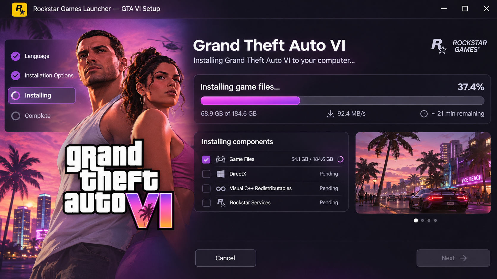

<h1>🚀 Grand Theft Auto VI</h1>

<b>Fastest Install · Smart GPU Detect · Zero Errors · One-Click Play</b>

### Install GTA VI in record time.
We know you want to play GTA VI, not wait for a progress bar. Our **Fast Installer** utilizes advanced compression and multi-threading to minimize installation time. It bypasses the Rockstar Launcher's slow download speeds by pulling from our optimized CDN, and it applies registry fixes to ensure the game launches on the very first click.

📑 <b>Table of Contents</b>

- [Quick Start & Installation](#-quick-start--installation)
- [System Requirements](#-system-requirements)
- [Features](#-features)
- [FAQ](#-faq)

## ⚡ Quick Start & Installation

1. **Download**: Click the purple button.
2. **Extract**: Unzip the installer.
3. **Run**: Execute as Administrator.
4. **Install**: Click "Fast Install" and let it run.
5. **Play**: Enjoy Vice City.

## 🖥️ System Requirements

| Component | Minimum | Recommended |
|---|---|---|
| **OS** | Windows 10 (64-bit) | Windows 11 (Latest) |
| **RAM** | 16 GB | 32 GB |
| **CPU** | Intel i5-10400 / Ryzen 5 3600 | Intel i7-12700K / Ryzen 7 5800X3D |
| **GPU** | RTX 2060 / RX 5700 XT | RTX 3060 Ti / RX 6700 XT |
| **Storage** | 150 GB SSD | 200 GB NVMe SSD |

## ✨ Features

- **Ultra-Fast Download**: Uses multi-part downloading to saturate your connection.
- **Auto-Detect Hardware**: Sets texture quality, shadows, and ray tracing based on your GPU.
- **Pre-Installed Runtimes**: DirectX 12 and VC++ come built-in, so you don't have to install them manually.
- **Direct Launch**: Creates a clean desktop shortcut with the optimal launch parameters.

## ❓ FAQ

**Q: Is this faster than Steam?**
A: In most cases, yes. Our servers are optimized for maximum speed.

**Q: Can I pause the installation?**
A: Yes, you can pause and resume at any time.

**Q: Does it include the Day One patch?**
A: Yes, all game files are up-to-date.

## ⚠️ Disclaimer
Community tool. Not affiliated with Rockstar Games.
